<p align="center">
  
</p>

<h1 align="center">D1A</h1>

<p align="center"><b>A small decision model on Gemma 4.</b> One document and a set of typed questions in, a calibrated probability for every option out, in one forward pass. No text generation.</p>

<p align="center">
  <a href="https://github.com/jonpol01/d1a/actions/workflows/ci.yml"></a>
  <a href="https://github.com/jonpol01/d1a/actions/workflows/license.yml"></a>
  <a href="https://github.com/jonpol01/d1a/releases"></a>
  <a href="LICENSE"></a>
  <a href="pyproject.toml"></a>
</p>
<p align="center">
  <a href="https://huggingface.co/google/gemma-4-E4B"></a>
  <a href="https://huggingface.co/JohnP1/d1a-e4b"></a>
  <a href="https://huggingface.co/collections/JohnP1/d1a-for-pytorch-cuda-cpu-non-mac"></a>
  <a href="https://huggingface.co/collections/JohnP1/d1a-for-mlx-apple-silicon-gpu"></a>
  <a href="https://huggingface.co/collections/JohnP1/d1a-for-core-ml-apple-neural-engine"></a>
  <a href="https://huggingface.co/mlx-community/d1a-e4b-8bit"></a>
  <a href="https://github.com/jonpol01/d1a-playground"></a>
</p>

> **Built on Kev.** D1A is built on [Kev](https://github.com/jaredpalmer/kev) by Jared Palmer, licensed under the [Apache License 2.0](LICENSE). The model code, trainer, benchmark and frozen evaluation suites here started as a copy of Kev (upstream commit `0fe8fc9`); [docs/UPSTREAM.md](docs/UPSTREAM.md) lists every file taken from Kev and what D1A changed. D1A is an independent project. It is not affiliated with, sponsored by or endorsed by Jared Palmer or the Kev authors.

## Proven at

- **Agent decisions** (D1A-E4B-it v0.6, held-out agent items): tool-call gate 98%, task judge 92%, model routing 45 of
  45 hand-labelled prompts. With the fail-safe advice, 0 of 33 calls that should be asked or denied were allowed
  ([docs/AGENTS_GUIDE.md](docs/AGENTS_GUIDE.md)).
- **Hard decisions, developer tools, long documents, Japanese** (D1A-E4B-it v0.6, D1A's skill suites): 75.7%, 74.3%,
  88.6% and 78.6% ([docs/MODELS.md](docs/MODELS.md)).
- **Decisions and chat in one model:** with its adapter off, D1A-E4B-it is Gemma 4 E4B-it behind an OpenAI-format
  endpoint, and the prompt cache brings an agent step on a 20k-token prompt from 33 s to 1–1.7 s (M1 Max).
- **PR labeling in daily use** (D1A-E4B v0.6): 0.63 s per PR on an M4; on 487 PRs newer than all its training,
  severity 79% and change type 91% ([recipes/pr-labeler](recipes/pr-labeler/README.md)).
- **Photos, voice and video,** zero-shot through Gemma 4's own encoders ([docs/DEMOS.md](docs/DEMOS.md)).

## Quick Start

You need Python 3.12 or 3.13 and [uv](https://docs.astral.sh/uv/).

```bash
git clone https://github.com/jonpol01/d1a.git && cd d1a
uv sync --extra serve
uv run --extra serve python -m d1a.serving.serve --run JohnP1/d1a-e4b-mlx-q8@v0.6.1 --port 8009
```

That serves the MLX build on Apple Silicon. Elsewhere pass the PyTorch build, `--run JohnP1/d1a-e4b@v0.6.1` (CUDA if you have a GPU; `D1A_BACKEND=torch` runs PyTorch on MPS, see [Apple Silicon (MLX)](docs/APPLE.md#apple-silicon-mlx)). The first run downloads the model. `--run` also takes a local checkpoint directory or a Hub revision (`repo@rev`).

Every setting (server flags, `D1A_*` variables, self-learning, photos and voice, agents) is listed with its default and
when to change it in [docs/CONFIGURATION.md](docs/CONFIGURATION.md).

Send it a ticket:

```bash
curl -s localhost:8009/v1/systemone -H 'content-type: application/json' -d '{
  "state": "Shoes arrived two weeks late and in the wrong size. Also I see two charges on my card.",
  "model": "d1a-latest",
  "questions": {
    "team":   {"type": "choice", "instructions": "Which team should handle this?",
               "criteria": {"returns": null, "shipping": null, "billing": null}},
    "urgent": {"type": "noul", "instructions": "Does this need a reply today?"}
  }
}'
```

## Pick a Build

| | PyTorch | MLX 8-bit (Apple Silicon) | Core ML (preview) | Use when |
|---|---|---|---|---|
| D1A-E4B | [d1a-e4b](https://huggingface.co/JohnP1/d1a-e4b) | [d1a-e4b-mlx-q8](https://huggingface.co/JohnP1/d1a-e4b-mlx-q8), 7.5 GB with media | [d1a-e4b-coreml](https://huggingface.co/JohnP1/d1a-e4b-coreml), 6.5 GB | decisions on a server or a Mac: the default build, with a routing temperature |
| D1A-E2B | [d1a-e2b](https://huggingface.co/JohnP1/d1a-e2b) | [d1a-e2b-mlx-q8](https://huggingface.co/JohnP1/d1a-e2b-mlx-q8), 4.8 GB with media | [d1a-e2b-coreml](https://huggingface.co/JohnP1/d1a-e2b-coreml), 3.8 GB | decisions on a phone or a small machine |
| D1A-E4B-it | [d1a-e4b-it](https://huggingface.co/JohnP1/d1a-e4b-it) (adapter) | [d1a-e4b-it-mlx-q8](https://huggingface.co/JohnP1/d1a-e4b-it-mlx-q8), 7.5 GB with media; [-mlx-q4](https://huggingface.co/JohnP1/d1a-e4b-it-mlx-q4), 5.2 GB | [d1a-e4b-it-coreml-4bit](https://huggingface.co/JohnP1/d1a-e4b-it-coreml-4bit), 4.6 GB | decisions and chat in one model: agents and local apps |
| D1A-E2B-it | [d1a-e2b-it](https://huggingface.co/JohnP1/d1a-e2b-it) (adapter) | [d1a-e2b-it-mlx-q8](https://huggingface.co/JohnP1/d1a-e2b-it-mlx-q8), 4.8 GB with media; [-mlx-q4](https://huggingface.co/JohnP1/d1a-e2b-it-mlx-q4), 3.6 GB | [d1a-e2b-it-coreml](https://huggingface.co/JohnP1/d1a-e2b-it-coreml), 3.8 GB; [-4bit](https://huggingface.co/JohnP1/d1a-e2b-it-coreml-4bit), 2.9 GB | decisions and chat on a phone |
| D1A-E2B-it QAT (experimental) | coming (#346) | [d1a-e2b-it-qat-mlx-q4](https://huggingface.co/JohnP1/d1a-e2b-it-qat-mlx-q4), 3.8 GB with media, 4-bit on Google's QAT int4 trunk, unmerged (chat) | — | decisions, chat, photos, voice and video in 4-bit on Apple Silicon; not a replacement for D1A-E2B-it v0.6 (transfer −5.2 points) |

E4B is the more accurate size; E2B is smaller and faster, for phones and small machines. The `-it` models are trained the same way on the instruction-tuned Gemma 4 trunks, so one model also chats: with its D1A adapter off it is Gemma 4 E4B-it / E2B-it. Chat needs an unmerged build (`scripts/export_mlx.py --unmerged`, [Chat with D1A](docs/USAGE.md#chat-with-d1a)); the published `-mlx-q8` / `-mlx-q4` repos have the adapter merged and answer decisions only. D1A-E4B-it is about 2.9× slower per decision than D1A-E2B-it and more accurate on 21 of 22 suites. The PyTorch and MLX builds of D1A-E4B and D1A-E2B are at `v0.6.1` (v0.6 plus a routing temperature); the `-it` and Core ML builds are at `v0.6`. Core ML is a preview for iPhone/iPad: text only, inputs up to 512 tokens, and MLX is faster on Macs ([docs/APPLE.md](docs/APPLE.md)); the 4-bit E4B-it build moves 3 of 42 test answers, so use MLX 8-bit where answers must not move. Sizes, exceptions and older versions: [docs/MODELS.md](docs/MODELS.md).

## Use It

`POST /v1/systemone` takes a `state` (the document) and `questions`, each a `noul` (yes/no), `choice` or `score`. The response has a probability for every option of every question. The same shape works in your own code, without a server:

```python
from d1a import D1A

m = D1A.load("JohnP1/d1a-e2b-mlx-q8")   # Apple Silicon (MLX, 3.8 GB download); JohnP1/d1a-e2b on NVIDIA or CPU
answers = m.decide("Shoes arrived late and I was charged twice.",
                   {"team": {"type": "choice", "instructions": "Which team should handle this?",
                             "criteria": {"returns": "returns", "shipping": "shipping", "billing": "billing"}},
                    "urgent": {"type": "noul", "instructions": "Is this urgent?"}})
print(answers["team"]["probabilities"], answers["urgent"]["noul"])
```

- Clients for Python and JS: [docs/USAGE.md](docs/USAGE.md#clients)
- Agents (MCP tools, the Claude Code gate hook, a demo): [docs/AGENTS_GUIDE.md](docs/AGENTS_GUIDE.md)
- Photos, voice and video: [docs/USAGE.md](docs/USAGE.md#photos-voice-and-video)

## For Agents

D1A makes an agent's small decisions fast and fail-safe: who takes a request, how large a model it needs, whether a
tool call may run (allow, ask, deny), and whether a task is done.
- **Three ways in:** MCP tools for any agent, a Claude Code gate hook, or Python presets.
- **Try it:** `python -m d1a.agents.demo` walks one task through an agent's day.
- **Measured:** on held-out agent items, with the fail-safe advice, it allowed 0 of 33 calls that should be asked or
  denied, and closed 0 of 33 unfinished tasks.
- **Limit:** it catches 60% of public prompt injections, so it is a second opinion, not a security boundary.

Guide, demo output and numbers: [docs/AGENTS_GUIDE.md](docs/AGENTS_GUIDE.md).

## How It Works

1. **The input.** The document goes in once; each question follows as its own branch with its options and a `<decide>` token.
2. **The model.** A Gemma 4 backbone with a LoRA adapter and a small pointer head score each option, and a calibrated softmax turns the scores into probabilities.
3. **Two ways to run it.** Packed (one sequence under a block-causal mask) or rows (the document cached, one short row per question), with the same answers.
4. **Where it runs.** `d1a.serving.serve` speaks the System One API on MLX or PyTorch, and reads photos, voice notes and video with Gemma 4's own encoders.
5. **Learning from outcomes.** Decisions are logged with the model that made them; when outcomes come back they refit the probabilities.

<picture>
  <source media="(prefers-color-scheme: dark)" srcset="docs/arch/model-dark.svg">
  
</picture>

Prose and the other diagrams: [docs/ARCHITECTURE.md](docs/ARCHITECTURE.md). The exact rules: [docs/SPEC.md](docs/SPEC.md).

## Learns From Outcomes

D1A logs every decision. When outcomes come back it recalibrates its probabilities (used in production), and it can retrain behind a held-out gate (no retrain has passed the gate yet). Details and numbers: [docs/SELF_LEARNING.md](docs/SELF_LEARNING.md).

## Demos

Thirteen use cases, each answered in one forward pass, are in [jonpol01/d1a-playground](https://github.com/jonpol01/d1a-playground); the recordings of twelve of them (all but the video check) are in [docs/DEMOS.md](docs/DEMOS.md).

<table>
<tr><td align="center" width="33%"><br><b>Model routing</b></td><td align="center" width="33%"><br><b>Tool-call gating</b></td><td align="center" width="33%"><br><b>Photo check</b></td></tr>
</table>

## Train Your Own

```bash
uv run python -m d1a.training.recipe run recipes/d1a-e2b.yaml --out runs/d1a-e2b --device cuda
```

One L4 is enough. Fine-tuning, calibration and scoring: [docs/TRAINING.md](docs/TRAINING.md); the recipes: [recipes/README.md](recipes/README.md).

## Status

As of 2026-10-22:

- D1A-E4B-it v0.6 is in daily use as one model: decisions (the PR labeler, and a Hermes agent's tool gate in shadow mode) and OpenAI-format chat and embeddings for local apps and agents, with a prompt cache.
- The SWE verifier is no better than cheap trajectory heuristics within an issue (a null result); recalibration on outcomes works ([docs/SELF_LEARNING.md](docs/SELF_LEARNING.md)).
- The photo, voice and video demos are zero-shot: the checkpoints are trained on text only ([docs/DEMOS.md](docs/DEMOS.md)).
- Core ML is a preview: text only, inputs up to 512 tokens, slower than MLX on Macs ([docs/APPLE.md](docs/APPLE.md)).
- Options within one question can still influence each other; asking questions together or separately gives the same probabilities, but option order is not irrelevant.
- The benchmark numbers Kev publishes are for Kev's own Qwen checkpoints, not D1A.
- Reports are in [docs/reports/](docs/reports/).

## Development

```bash
uv sync --extra serve
uv run python -m pytest tests --unit -q   # what CI runs: every test file but the few tests/conftest.py's OUTSIDE_UNIT_TESTS lists
python scripts/check_license.py          # license and provenance rules (see CONTRIBUTING.md)
uv run python scripts/equivalence/metrics.py   # a rewritten module against its last version before the rewrite (api, metrics, benchmark, suite)
```

These suites need no model weights (the tokenizer, about 10 MB, is downloaded from the Hub). `tests/test_model.py` and `tests/test_mlx.py` need real weights. `tests/test_api.py` serves the committed tiny checkpoint in process; set `D1A_BASE_URL` to run it against a running server instead (`pytest tests/test_api.py -m server`).

## Releases

D1A's code is versioned with [Semantic Versioning](https://semver.org) and released on [GitHub](https://github.com/jonpol01/d1a/releases); [CHANGELOG.md](CHANGELOG.md) says what changed in each version, and model checkpoints carry their own Hugging Face tags. How to cut a release: [CONTRIBUTING.md](CONTRIBUTING.md#releasing).

## License

Apache-2.0: see [LICENSE](LICENSE) and [NOTICE](NOTICE).

- D1A's code comes from [Kev](https://github.com/jaredpalmer/kev), Copyright 2026 Jared Palmer, Apache-2.0. Files taken from Kev and changed carry a notice at the top; [docs/UPSTREAM.md](docs/UPSTREAM.md) lists them and every change.
- D1A's changes are Copyright 2026 John Soliva, Apache-2.0.
- Gemma 4 is released by Google under Apache-2.0; the Qwen base models are also Apache-2.0. Training datasets have their own licenses.
- Authors: Kev by Jared Palmer ([@jaredpalmer](https://github.com/jaredpalmer)), built with [Devin](https://devin.ai); D1A by John Soliva ([@jonpol01](https://github.com/jonpol01)).
- Credits carried over from Kev: Kev thanks [Archer Hume](https://archerhume.com/posts/jevs-architecture-unmasked) for the architecture write-up, [TypeSafe](https://docs.typesafe.ai/api) for the API design, [Qwen](https://huggingface.co/Qwen/Qwen3.5-9B-Base) for the base models, [3x3xX3N0N](https://github.com/jaredpalmer/kev/issues/8) and [Radexito](https://github.com/Radexito) for their contributions. Related work: [Hydragen](https://arxiv.org/abs/2402.05099), [DeFT](https://arxiv.org/abs/2404.00242), [FIRST](https://arxiv.org/abs/2406.15657).
