# Architecture

What D1A is made of and how a request flows through it, with the diagrams; the exact rules are in [SPEC.md](SPEC.md).

## What It Is

D1A answers yes/no, multiple-choice and rating questions about a piece of text, the way an API call answers a function: routing a support ticket, gating an agent's tool call, triaging an inbox, ranking passages, grading an LLM's answer. Every answer comes with probabilities, so your code can act on the confident cases and send the rest to a person.

A causal LM backbone with a LoRA adapter runs one prefill pass over the document and the questions under a block-causal mask (each question sees the document and itself, never the other questions). A small pointer head scores each option's end token against the question's `<decide>` token, and a softmax turns the scores into probabilities. D1A's backbones are Gemma 4 E2B and E4B; the Qwen bases Kev was built for still work. It speaks the TypeSafe System One API (`POST /v1/systemone`), so the TypeSafe SDK and existing clients work against it.

## How It Works

**1. The input.** The document comes first, once. Each question follows as its own branch: `<q>` and the instructions, one `<opt> … </opt>` span per option, then `<decide>`. On Gemma 4 the five delimiters are the reserved tokens `<unused0>`–`<unused4>`, which user text cannot produce. Position ids restart after the document for every question, so each question sees exactly what it would see alone.

<picture>
  <source media="(prefers-color-scheme: dark)" srcset="arch/layout-dark.svg">
  , the options and <decide>" width="100%">
</picture>

**2. The model.** A Gemma 4 backbone with a LoRA adapter, and a small pointer head. The head turns the hidden state at `<decide>` into a query and the hidden state at each `</opt>` into a key; their scaled dot products are the option scores. Dividing by a temperature fitted on held-out data makes the probabilities calibrated without changing the top answer.

<picture>
  <source media="(prefers-color-scheme: dark)" srcset="arch/model-dark.svg">
  
</picture>

**3. Two ways to run it, same answers.** *Packed* runs the whole request as one sequence under a block-causal mask. *Rows* reads the document once into a prefix cache, then runs each question as its own short row. Short requests run packed; long documents, cached documents, hybrid backbones and the MLX path run as rows. A test checks that both agree.

<picture>
  <source media="(prefers-color-scheme: dark)" srcset="arch/forms-dark.svg">
  
</picture>

**4. Where it runs.** `d1a.serving.serve` speaks the System One API, on MLX on Apple Silicon and on PyTorch elsewhere. The same server and the same model answer about a photo, a voice note or a video: Gemma 4's own vision and audio encoders turn the media into tokens the model reads, so there is no captioning or speech-to-text step, and `--idle-unload` frees the memory when nobody is asking ([Photos, Voice and Video](USAGE.md#photos-voice-and-video)).

<picture>
  <source media="(prefers-color-scheme: dark)" srcset="arch/serving-dark.svg">
  
</picture>

**5. Learning from outcomes.** Every decision is logged with the model that made it (`d1a.learning.feedback.FeedbackLog`). When the outcome is known, three steps run, cheapest first: an `OutcomeCalibrator` refits each yes/no probability on the outcomes (Platt scaling, which also corrects a shifted base rate) and each choice question's temperature (how sure it is, never which option it picks), a small LoRA update trains on the resolved decisions, and `gate()` promotes the candidate only if its held-out log loss is lower with a 95% bootstrap interval clear of zero and no frozen suite regressed. A promoted candidate becomes the next version through `d1a.core.versions`.

<picture>
  <source media="(prefers-color-scheme: dark)" srcset="arch/learning-dark.svg">
  
</picture>

The diagrams are generated by [`docs/arch/make_svgs.py`](arch/make_svgs.py).

The exact rules (how a request becomes tokens, the attention rule, the pointer head, the answer formats, the checkpoint formats and the conformance test a port must pass) are in [docs/SPEC.md](SPEC.md).
