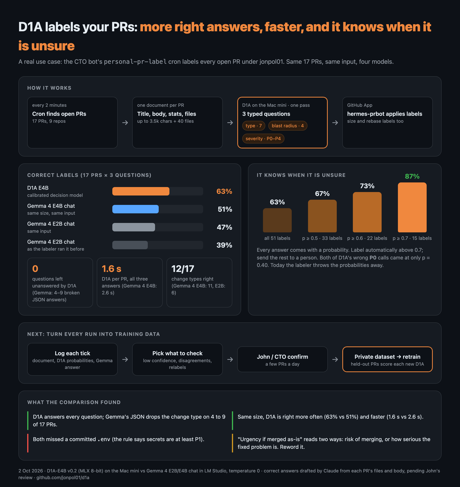

# PR labeler recipe

How D1A-E4B v0.3 learned to label pull requests: change type (7 labels), blast radius (4) and severity (P0–P4), asked
exactly as a production labeling job asks them. Every step is a script here, so the next round, another language or
another project's labels repeat it without guesswork.

| Step | Script | Runs on |
|---|---|---|
| 1. Fetch labeled PRs | `fetch_prs.py` | anywhere with the GitHub CLI |
| 2. Build records and split | `to_records.py` (uses `labeler_spec.py`) | anywhere |
| 3. Translate (optional) | `translate.py`, then `clean.py` | a Mac (MLX) or any OpenAI-compatible server |
| 4. Train, calibrate, score | `train_job.sh` (`launch_hf_job.sh` for Hugging Face Jobs) | one NVIDIA GPU (an L4 is enough) |
| 5. Read the scores | `report_job.py` (job scores), `score_records.py` + `compare.py` (local) | anywhere |

## 1. Data

```bash
python fetch_prs.py prs.jsonl 1200                              # up to 1,200 closed PRs per type/* label
python fetch_prs.py prs.jsonl 400 P0,P4,sweeper:blast-massive    # top up rare labels
python to_records.py prs.jsonl records/                         # train / development / test .jsonl
```

`labeler_spec.py` is the labeling job's question wording and document builder, copied from production. Records built
from it ask what production asks, so the model is trained on the wording it will be asked in. Change both together.

The split is by time inside each label group (a record's rarest label: blast, then P0/P1/P4, then type): the newest 10%
is test, the next 10% development. Test PRs are newer than every training PR of their group.

Severity follows the job's rules where the source project differs (docs-only PRs and dependency bumps without an
advisory are P4). For another project, check its conventions against `labeler_spec.SEVS` before training.

## 2. Another language

```bash
python translate.py ja records/train.jsonl train_ja.raw.jsonl --n 960 --seed 3                  # Mac: Gemma 4 E4B on MLX
python translate.py ko records/train.jsonl train_ko.raw.jsonl --endpoint http://localhost:8000/v1 # vLLM, LM Studio, Ollama...
python clean.py ja records/train.jsonl train_ja.raw.jsonl records/train_ja.jsonl
```

Only the title and description are translated; files, stats and the questions stay as they are (the job asks in
English). `clean.py` drops broken outputs (about 20% for Japanese with a 4B translator). Do the same for development and
test, so the language gets its own scores.

The v0.3 data is the private dataset `JohnP1/d1a-pr-labels` (7,563 / 946 / 953 English, 768 / 95 / 92 Japanese). New
languages go next to it as `train_<lang>.jsonl`, `development_<lang>.jsonl`, `test_<lang>.jsonl`.

Training and scoring read it as a D1A suite, pinned to one dataset commit: `evals/d1a/pr-labels/manifest.json` holds each
partition's sha256 and record count (the text stays in the dataset), and `evals/d1a/ja-jglue` and `evals/d1a/routing`
pin the replay data the same way. After adding files to the dataset, pin the new commit:

```bash
uv run python -m d1a.eval.suites freeze evals/d1a/pr-labels --dataset JohnP1/d1a-pr-labels \
    --partition train=train.jsonl:train --partition train-ja=train_ja.jsonl:train ... --partition test=test.jsonl:eval
```

`mix.py` builds the training mix from them (every rare-label PR plus a sample of the rest, extra partitions, JGLUE and
routing replay) and writes `<out>.json` beside it: the inputs' hashes, the parameters and the mix's own sha256. A
partition marked `eval` is refused for training.

## 3. Train

`train_job.sh` trains from `INIT` with replay of D1A's earlier data, calibrates on pooled held-out rows, uploads the
checkpoint, and scores the start and the result at full length (`--context serving`, as the labeling job sends PRs). Its
header lists every setting. On Hugging Face Jobs:

```bash
./launch_hf_job.sh pr-labeler-v2 6h EN=3500 EN_SKIP=1 EXTRA="train-ja train-blast"   # round 2: continue v0.3
```

On your own NVIDIA machine, run it in the same image (it works in absolute paths such as `/data` and `/runs`):

```bash
docker run --gpus all -e HF_TOKEN -e D1A_SHA=$(git rev-parse origin/main) -e REPO=you/runs -e PREFIX=try1 \
  -v $PWD/ckpt:/ckpt ghcr.io/astral-sh/uv:python3.13-bookworm bash -c "apt-get -qq update && apt-get -qq install -y git; $(cat train_job.sh)"
```

Budget about 1.26 s per PR record on an L4 (PR documents average ~680 tokens) plus about an hour of scoring. v0.3
(4,268 PRs plus replay, 813 steps) cost $2.34. Always run with a timeout: resume points are saved every 15 minutes, and
relaunching with the same `PREFIX` continues the run.

`--max_state 1536` matters: the trainer's default of 384 tokens silently drops most PRs.

## 4. Scores

```bash
hf download JohnP1/d1a-e4b-runs --include 'pr-labeler-v2/eval/*' --local-dir out
python report_job.py out/pr-labeler-v2/eval
```

Locally (any device D1A runs on): `python score_records.py JohnP1/d1a-e4b-mlx-q8@v0.3 records/test.jsonl after-test.json`,
the same for the starting model as `before-test.json`, then `python compare.py . test`.

## History

How the labeler got here: the first 17 PRs, then v0.3 and v0.4.

D1A's first everyday job: a scheduled job labels every open pull request in jonpol01's repositories with D1A on a Mac mini. One request per PR (title, description, stats and changed files) answers three typed questions at once: change type (7), blast radius (4) and severity (P0–P4). Answers below p 0.7 add `review:needs-human`.

On the same 17 PRs and the same input, D1A-E4B got 63% of the labels right against 51% for Gemma 4 E4B chat (39% for the Gemma 4 E2B setup it replaced), answered every question where the chat models' JSON dropped some, and took 1.6 s per PR. Above p 0.7 it was right 87% of the time. Since then D1A-E4B **v0.3** has been fine-tuned for the job on 3,500 English and 768 Japanese pull requests labeled with the same taxonomy (one L4 GPU, $2.34), and the Mac mini now serves it. On 953 held-out PRs it gets 78% of the labels right (v0.2: 50%), and 93% of those it gives at p ≥ 0.7, which is 57% of them; on 92 Japanese PRs 70% (v0.2: 40%). Blast radius stays the weak label (54%). A second round, **v0.4** (4,063 more English PRs and 2,185 more with a blast-radius label, $3.77), raised that to 81% (severity 70% → 78%, Japanese 74%, the 17 real PRs 61% → 69%), confident on 65% of labels, at a cost of 1–3 points on D1A's other skills; the Mac mini now serves v0.4. The data steps, training job and scoring scripts are in [`recipes/pr-labeler`](.). Try it in the [playground](https://github.com/jonpol01/d1a-playground) (demo 12).



## One checkpoint, every device

Training produces a LoRA adapter plus a pointer head (about 145 MB). Nothing is device-specific, so no device needs its
own training run:

- **NVIDIA GPUs and CPUs:** `python -m d1a.serving.serve --run JohnP1/d1a-e4b@v0.3` loads it as is (PyTorch).
- **Apple Silicon:** export once to MLX and serve the folder:
  `uv run --extra mlx python scripts/export_mlx.py --run JohnP1/d1a-e4b@v0.3 --q-bits 8 --q-per-layer-bits 4 --out runs/exports/d1a-e4b-v0.3-mlx-q8`
  (published as `JohnP1/d1a-e4b-mlx-q8@v0.3`).
- **Phones:** the same checkpoint will convert once the phone runtime lands (issues #27, #28, #75).

Retrain only to teach something new (a new language, another project's labels), never to move to a new device.

## The label standard

D1A uses hermes-agent's label set only: `type/*` (7), `P0`–`P4`, and blast radius (hermes-agent's `sweeper:blast-*`, named
`review:blast-*` here). No other labels.

**Labels are used by their written definitions, not by the habits of whoever labelled the training PRs** (John, 2026-10-12,
jonpol01/d1a#252). The definitions are hermes-agent's own label descriptions:

| Label | Definition |
|---|---|
| P0 | Critical — data loss, security, crash loop |
| P1 | High — major feature broken, no workaround |
| P2 | Medium — degraded but workaround exists |
| P3 | Low — cosmetic, nice to have |
| P4 | Best-effort: we will get to it when we get to it (no commitment) |
| blast contained | one narrow path / opt-in / few users |
| blast moderate | a subsystem or single platform |
| blast broad | a core path most sessions hit |
| blast massive | everyone, every turn (invariant surface) |

The labeler's own rules stay: Dependabot lockfile bumps without a CVE are P4, docs-only is P4, CI or test infrastructure
that can block main is P2.

What #252 measured on hermes-agent PRs D1A never trained on, using two judges that agree (the review bot and the Fable
adviser, each reading the definitions; "silver"):
- Change type: the maintainers' labels match the definitions (98.5%) and so does D1A v0.6 (95.6%).
- Severity: the maintainers' labels match the definitions on only about 60% of rows, mostly bug fixes labelled P3 that
  the text makes P2, and D1A, trained on them, copies that (56.5%).
- Blast: `labeler_spec.py` words blast by code structure ("one module", "shared helper"), while hermes-agent's definitions
  measure how many users a mistake reaches.

**Served now** (jonpol01/d1a#259): for requests that send `"use_case": "pr-labeler"`, D1A-E4B v0.6's severity is decoded by
one rule, `rules.sev_p2` in the server's `D1A_LEARNING` settings: a P3 or P4 answer is served as P2 when p(P2) ≥ 0.20. On a
second silver set the threshold was not fitted on (87 PRs), served severity matched the definitions 70.1% of the time, against
59.8% for v0.6's top answer and 58.6% for the maintainers' labels (+10.3 points over the top answer, 95% CI +2.3 to +18.4).
The rule only ever raises P3/P4 to P2, so P0 and P1 stay the model's; the probabilities and the decision log stay the model's,
and the served answer names the rule.

**For the next training round** (the rule stands in until then):
- the severity instructions get one tie-break: *a bug fix is P2 when the defect took away or degraded something users
  rely on, even with a workaround; P3 only when it was cosmetic, a convenience, or hit almost nobody. A new feature is P3
  unless it unblocks a P1 or P2 problem*;
- the blast wording in `labeler_spec.py` follows hermes-agent's definitions above;
- severity training rows that conflict with the definitions are relabelled where both judges agree, or dropped;
- severity is scored against the silver rows; agreement with the maintainers' labels is reported but may fall, by design.

## Credits

Pull-request data from NousResearch/hermes-agent (MIT). Japanese replay data derived from JGLUE (CC BY-SA 4.0).
